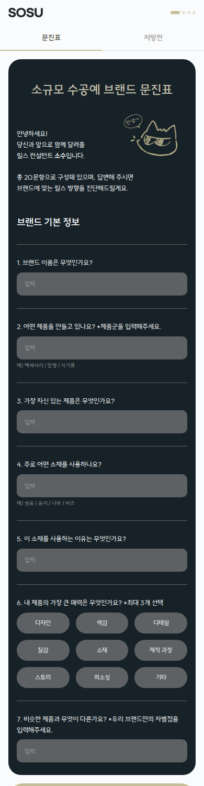
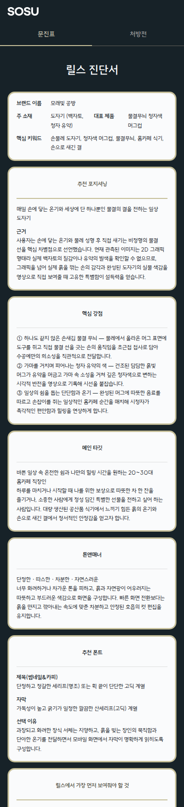
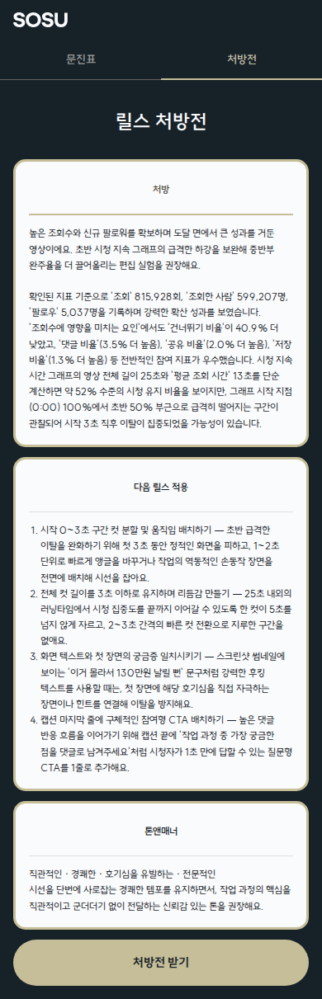
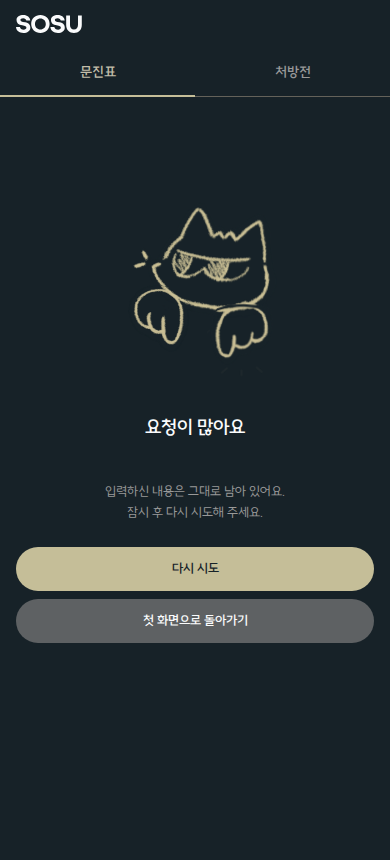
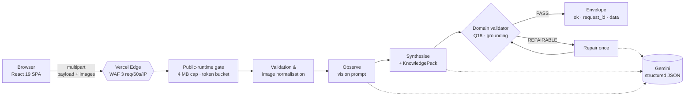

# SOSU — 수공예 브랜드를 위한 AI 릴스 컨설팅

> 설문 20문항과 제품 사진으로 **릴스 진단서**를, 인스타그램 인사이트 캡처 3장으로 **릴스 처방전**을 만들어 주는 웹 서비스입니다.
> React와 FastAPI로 만들었고 Gemini로 구조화된 결과를 생성하며, Vercel에서 공개 운영 중입니다.

**Live** → <https://sosu-rosy.vercel.app> · API <https://sosu-py.vercel.app/api/v1/features>

- 공개 데모는 실제 유료 모델을 호출합니다.
- 비용 안전장치로 IP당 60초에 3회로 요청을 제한하고, 월 사용 상한도 걸려 있습니다.

| 문진표 | 릴스 진단서 (라이브 결과) | 릴스 처방전 (라이브 결과) | 요청 제한 시 화면 |
|---|---|---|---|
|  |  |  |  |

## 무엇을 하나요

| 워크플로우 | 입력 | 출력 |
|---|---|---|
| **문진표 → 진단서** | 브랜드, 고객, 릴스 방향 20문항(3단계)과 제품 사진(선택) | 포지셔닝, 핵심 강점, 타깃, 톤앤매너, 추천 폰트, 우선순위, 추천 릴스 유형, 0~30초 구성, 최종 가이드 등 9개 섹션 |
| **인사이트 → 처방전** | 릴스 URL과 인사이트 캡처 3장 | 실제 지표를 근거로 한 진단과 다음 릴스에 적용할 4단계 액션, 톤 |

가이드북(『가이드북 2차』)의 규칙 93개를 **KnowledgePack**으로 구조화해 생성 프롬프트에 함께 넣습니다. 원본 PDF는 공개하지 않습니다.

## 아키텍처



| 레이어 | 기술 | 레포 |
|---|---|---|
| 프론트 | Vite 8, React 19, TypeScript, react-router 7, Figma Variables에서 생성한 디자인 토큰 | [`web/`](web/) |
| 백엔드 | Python 3.12, FastAPI, Pydantic v2, google-genai, uv | [`SOSU_py/`](SOSU_py/) (submodule → [Siegfriex/SOSU_py](https://github.com/Siegfriex/SOSU_py)) |
| 계약 | OpenAPI와 fixture를 런타임 모델에서 생성 | [`contracts/`](contracts/) |
| 운영 | Vercel 프로젝트 2개(정적 SPA, Python 함수 200초), Vercel Firewall | — |

## 엔지니어링에서 신경 쓴 점

1. **계약 우선(Contract-first).**
   - 프론트와 백엔드는 생성된 `contracts/` 세 파일로만 연결됩니다.
   - 실제 계약과 어긋나면 검증 스크립트(`check_openapi`, `release --check`)가 실패합니다.
   - 오류는 `retryable`이 붙은 타입 코드로 정의했고, 화면도 코드마다 따로 있습니다(준비 중, 요청 많음, 시간 초과, 입력 보완).
2. **공개 환경에서는 기본적으로 닫힌 상태로 시작합니다.**
   - 운영 런타임에서는 `SOSU_PUBLIC_INFERENCE_ENABLED`를 켜기 전까지 AI 경로가 503을 반환합니다.
   - 공개 전에 게이트 12개(G1~G12)를 점검했습니다. 항목은 WAF 실측, 비용 상한, 시크릿 스캔, 배포된 SHA와 리뷰한 SHA의 일치 등입니다.
   - 이메일 발송, 이미지 보관, 외부 리서치는 구현하거나 설계까지 마쳤지만 **꺼져 있습니다**. 상태는 `/api/v1/features`에서 확인할 수 있습니다.
3. **엣지 429까지 처리하는 프론트.**
   - Vercel WAF의 429 응답에는 CORS 헤더가 없어서 브라우저에서는 단순 네트워크 실패로 보입니다.
   - 그래서 health를 다시 확인합니다. 서버가 살아 있으면 "요청이 많아요" 화면을 보여 줍니다.
   - mock으로 몰래 대체하는 경로는 없습니다. 연결이 안 되면 항상 오류 화면이 나옵니다.
4. **LLM 출력은 검증하고, 실패하면 1회 수리합니다.**
   - 결과는 Pydantic 스키마로 다시 검증합니다.
   - 도메인 validator가 placeholder, Q18 제약(얼굴·목소리 공개 불가 시 나레이션 금지)을 확인합니다. 부정 표현 window를 두어 "자막으로 대신" 같은 문장은 통과시킵니다.
   - 처방에서는 근거 이탈도 확인합니다. 계정명이나 URL에서 유추한 내용, 영상을 직접 봤다는 주장 등이 대상입니다.
   - 검사에 걸리면 repair 프롬프트를 딱 한 번 실행합니다.
   - 라이브 처방에서 계정명을 번역해 영상 내용을 지어낸 버그(RD-5)가 있었습니다. 근본 원인을 분석한 뒤 결정론 테스트 29개를 추가해 고쳤습니다.
5. **요청 단위 시간 예산.**
   - 요청 하나에 180초를 주고, 각 단계의 timeout과 재시도는 남은 시간에서 2초를 뺀 만큼으로 제한합니다.
   - 최악의 경우에도 Vercel 한도(200초)보다 먼저 504로 정리됩니다.
6. **키 없이 돌아가는 테스트 환경.**
   - 실제 `create_app()`에서 Gemini gateway만 결정론 fake로 바꾼 개발 서버가 있습니다.
   - 타임아웃, 수리 실패, 느린 응답 등의 시나리오를 실제 브라우저에서 재현할 수 있습니다.

## 테스트

| 스위트 | 범위 | 결과 |
|---|---|---|
| backend `pytest` + ruff, mypy, openapi, contract, KnowledgePack 검사 | 단위 테스트, 파이프라인, 보안, 근거 검증(RD-5), 시간 예산(RD-6) | 401 통과, 1 스킵 |
| `web` e2e / media / adapter | mock 빌드 UI 흐름, 이미지 예산, 계약 어댑터 | 47 / 6 / 12 |
| `e2e:integration` | 실제 Chrome → 프로덕션 빌드 → 실제 HTTP → FastAPI(fake gateway) | 24 |
| **`e2e:prod` (Playwright, 운영 대상)** | 무료 14건: 라우트 11개 × 3개 해상도, CORS, 번들, 입력 검증, 오류 화면 stub. 유료 시 라이브 진단·처방 각 1건, WAF 모드 시 WAF 실측 | 14/14, 라이브 2/2, WAF 통과 |

운영 E2E에는 요청 원장(ledger)이 있습니다.
- 구간별 예산(무료 0, 유료 2, WAF 6)을 넘는 AI 요청은 브라우저 밖으로 나가기 전에 차단합니다.
- 결과: [docs/engineering-log/SOSU_PROD_E2E_PLAYWRIGHT.md](docs/engineering-log/SOSU_PROD_E2E_PLAYWRIGHT.md)

## 로컬 실행

```bash
git clone --recurse-submodules https://github.com/Siegfriex/sosu.git && cd sosu

# 백엔드 (키 없이도 실행됨: 생성 요청은 타입 오류로 즉시 실패)
cd SOSU_py && uv sync && cp .env.example .env.local
uv run uvicorn app.main:app --reload --port 8000        # 또는 결정론 fake: .venv/bin/python scripts/serve_fake.py

# 프론트
cd ../web && npm install && npm run dev                 # http://localhost:5173 → http://127.0.0.1:8000
```

## 레포 구조

```
sosu/
├─ web/                 React SPA, 로컬 테스트 하네스(scripts/), 운영 Playwright 스위트(e2e/)
├─ SOSU_py/             FastAPI + Gemini 서비스 (git submodule)
├─ contracts/           공유 계약 릴리스: 도메인 문서, OpenAPI, fixture (생성물)
└─ docs/
   ├─ assets/           README 스크린샷 (운영 라이브 결과)
   └─ engineering-log/  단계별 감사, 통합, 출시 기록 (Stage 0 → Phase 3 → 운영 E2E)
```

## 개발 과정

1. 2026-09-13: Figma 디자인 시스템 기반 프론트 MVP(mock), 백엔드 계약 v1.0
2. Stage 1: 실제 HTTP 통합, 결정론 fake gateway, 가이드북 KnowledgePack
3. Phase 2: 라이브 Gemini 검증, Vercel 배포, 공개 게이트, 이메일 발송(꺼둔 상태)
4. Phase 3: RD-5 근거 이탈 수정, RD-6 시간 예산, WAF, 게이트 G1~G12, 공개 활성화
5. 출시 후: 운영 Playwright E2E

단계별 상세 기록: [docs/engineering-log/](docs/engineering-log/README.md)

## License

MIT © 2026 Siegfriex
