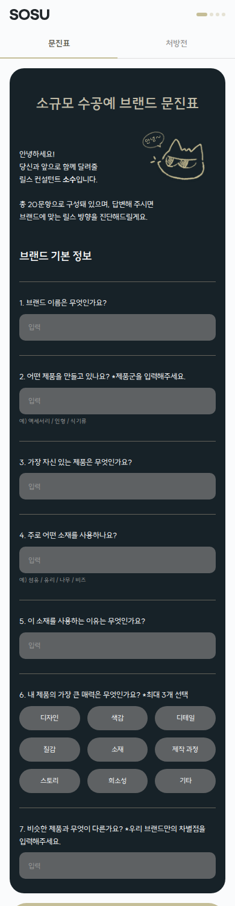
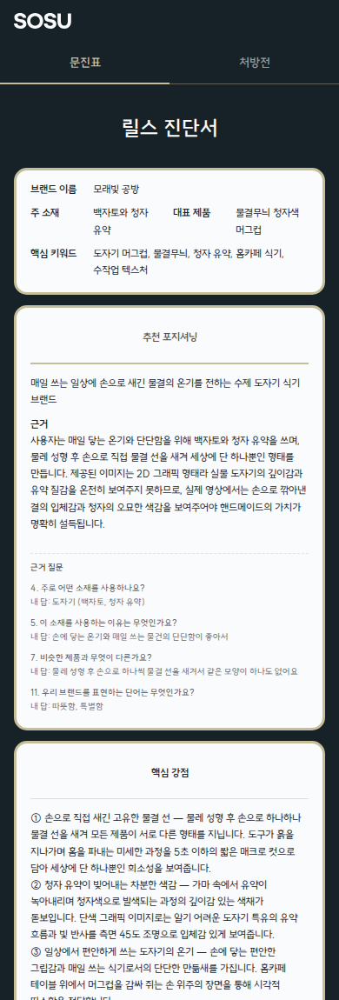
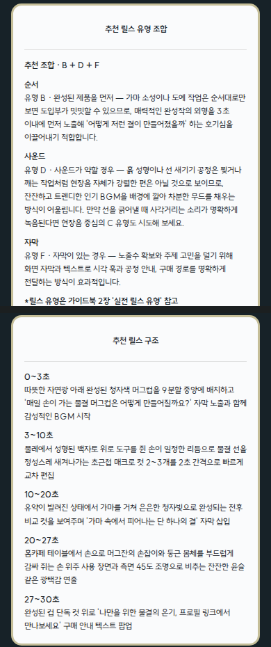
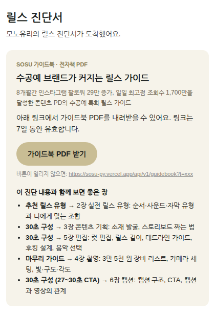
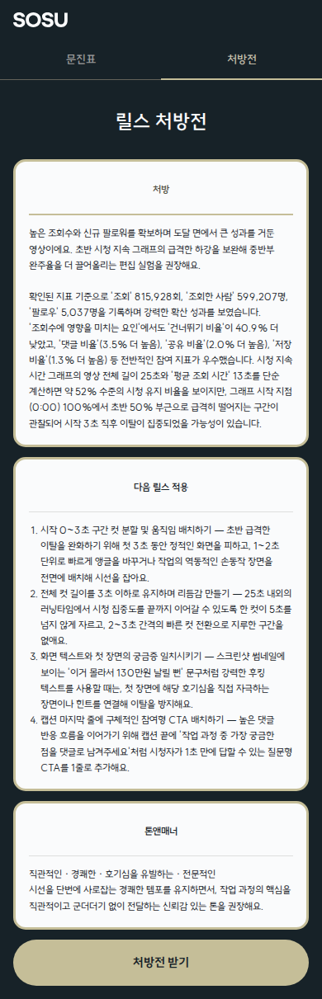
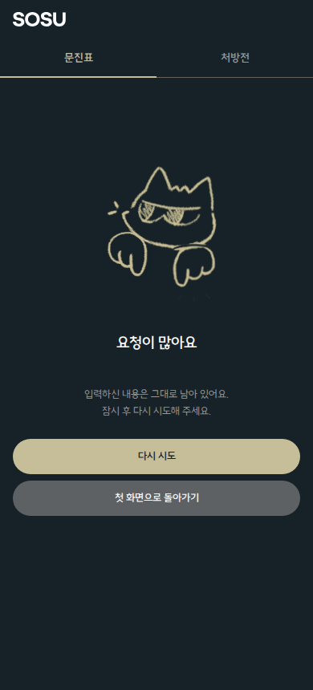
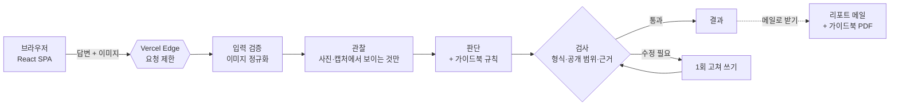

# SOSU · 수공예 브랜드를 위한 AI 릴스 컨설턴트

> 혼자 만들고 혼자 파는 수공예 작가가 **"내 브랜드는 어떤 릴스를 찍어야 하지?"** 에 답을 얻을 수 있게 돕는 웹 서비스입니다.
> 문진표 20문항에 답하면 **릴스 진단서**를, 올린 릴스의 인사이트 캡처 3장을 넣으면 **릴스 처방전**을 받습니다.

**바로 써 보기** → <https://sosu-rosy.vercel.app>

| 문진표 | 릴스 진단서 | 추천 유형과 30초 구성 | 메일로 받는 결과 |
|---|---|---|---|
|  |  |  |  |

---

## 1. 왜 만들었나요

작은 수공예 브랜드는 대부분 1인 작가가 운영합니다. 제품을 만들고, 사진을 찍고, 판매까지 혼자 하다 보니 릴스는 "뭘 찍어야 할지 모르겠다", "올려도 조회수가 안 나온다"에서 멈추기 쉽습니다. 일반적인 마케팅 조언은 대부분 얼굴을 드러내고 말로 설명하는 크리에이터를 전제로 하는데, 수공예 작가 상당수는 얼굴이나 목소리를 공개하고 싶어 하지 않습니다.

SOSU는 이 간극을 메우려고 만들었습니다.

- **내 브랜드에 맞춘 답**: "릴스는 3초가 중요해요" 같은 일반론 대신, 내 소재와 공정과 고객에 맞춘 30초 구성을 제안합니다.
- **얼굴·목소리 공개 범위를 지키는 답**: 공개하지 않겠다고 답하면 나레이션이나 얼굴이 나오는 장면은 제안하지 않습니다.
- **근거가 보이는 답**: 결과의 문장마다 어떤 질문의 어떤 답에서 나온 판단인지 함께 보여 줍니다.

## 2. 어떻게 쓰나요

### 릴스 진단서: 아직 무엇을 찍을지 모를 때
1. 문진표 3단계(브랜드 기본 정보 → 고객과 이미지 → 릴스 방향)의 20문항에 답합니다. 제품 사진은 선택이며 최대 3장까지 올릴 수 있습니다.
2. 30초쯤 기다리면 9개 섹션의 진단서가 나옵니다.
   - 포지셔닝, 핵심 강점, 메인 타깃, 톤앤매너, 추천 폰트 방향
   - 릴스에서 가장 먼저 보여 줘야 할 것(우선순위 3개)
   - **추천 릴스 유형 조합**과 **0~30초 구성**(0~3초 훅부터 27~30초 구매 안내까지)
   - 바로 실행할 수 있는 마무리 가이드
3. 진단서를 메일로 받을 수 있습니다. 메일에는 가이드북 PDF 링크와 "이 진단과 함께 읽으면 좋은 장" 안내가 함께 들어갑니다.

### 릴스 처방전: 이미 올린 릴스가 있을 때
1. 릴스 링크와 인스타그램 인사이트 화면 캡처 3장을 올립니다.
2. 조회수, 시청 시간, 이탈률 같은 **실제 지표를 근거로** 무엇이 약했는지 진단하고, 다음 릴스에서 할 일 4단계를 처방합니다.
3. 캡처에서 지표를 읽을 수 없으면 그럴듯한 일반론을 지어내지 않고, 다시 캡처해 달라고 안내합니다.

<p align="center"></p>

## 3. 가이드북을 서비스로 옮기기

SOSU의 판단 기준은 **『수공예 브랜드가 커지는 릴스 가이드』**(45쪽 전자책)입니다. 8개월 동안 인스타그램 팔로워를 29만 명 늘리고 일일 최고 조회수 1,700만을 기록한 콘텐츠 PD가 쓴, 수공예에 특화된 릴스 가이드입니다.

책을 통째로 AI에 넣지 않고, 그대로 적용할 수 있는 **규칙 93개**로 쪼개 구조화했습니다. 이 묶음을 KnowledgePack이라고 부릅니다.

```
가이드북 원문 ─▶ 규칙 93개 (쪽 번호, 적용 조건, 실행 방법)
   예) "작업 소리가 약하면 현장음을 빼고 인기 상승 음악을 BGM으로 깐다"  (2장, p11)
           │
           ▼  진단하거나 처방할 때마다 관련 규칙만 골라 함께 전달
   문진 답변 + 제품 사진 ─▶ AI ─▶ 진단서 / 처방전
```

릴스 유형은 가이드북 2장의 세 가지 축에서 하나씩 골라 조합합니다. AI가 유형 이름을 새로 지어낼 수 없도록 글자 하나만 고르게 하고, 화면에는 책에 나온 이름을 그대로 보여 줍니다.

| 축 | 선택지 |
|---|---|
| 순서 | **A** 제작 과정을 순서대로 · **B** 완성된 제품을 먼저 |
| 사운드 | **C** 사운드가 강할 경우(현장음) · **D** 사운드가 약할 경우(BGM) |
| 자막 | **E** 자막이나 나레이션이 없는 경우 · **F** 자막이나 나레이션이 있는 경우 |

예를 들어 조용한 공정의 도자기 브랜드가 구매 전환을 고민한다면 **B + D + F**(완성품을 먼저 보여 주고, BGM을 깔고, 자막으로 구매를 안내)가 나옵니다. 깨고 부수는 소리가 볼거리인 모자이크 작가가 편집을 어려워한다면 **A + C + E**(가장 빠르게 만들 수 있는 조합)가 나옵니다.

## 4. 디자인

- **Figma 디자인 시스템에서 코드로**: 색, 글꼴(SUITE), 간격, 모서리는 Figma Variables에서 디자인 토큰으로 뽑아 코드에 적용했습니다. 디자인을 바꾸면 토큰을 다시 생성하고, 어긋나면 검사(`npm run tokens:check`)가 실패합니다.
- **모바일 우선**: 대부분의 작가가 휴대폰으로 인스타그램을 운영하므로 320px부터 1440px까지 같은 흐름이 깨지지 않게 했습니다.
- **기다림과 실패도 화면으로**: AI가 결과를 만드는 30초 동안 고양이 캐릭터 '소수'가 함께 기다리고, 메일을 보낼 때는 소수가 손을 흔듭니다. 요청이 몰렸을 때, 시간이 초과됐을 때, 입력을 보완해야 할 때를 각각 다른 화면으로 안내합니다.
- **근거를 숨기지 않는 결과지**: 섹션마다 "근거 질문"을 각주처럼 달아 이 판단이 어떤 답에서 나왔는지 사용자가 직접 확인할 수 있습니다.

<p align="center"></p>

## 5. AI 결과를 믿을 수 있게 만든 방법

생성형 AI는 그럴듯하지만 틀린 말을 하기 쉽습니다. SOSU는 결과를 그대로 내보내지 않고 다음 단계를 거칩니다.

1. **관찰과 판단을 나눕니다.** 제품 사진과 인사이트 캡처는 먼저 "보이는 것만" 기록합니다. 판단은 그 기록을 바탕으로 따로 합니다.
2. **형식과 내용을 검사합니다.** 결과가 정해진 형식을 지켰는지, 얼굴·목소리 공개 범위를 어기지 않았는지, 영상을 보지도 않고 영상 내용을 말하지 않았는지 코드가 검사합니다. 걸리면 고쳐 쓰게 한 번 더 요청합니다.
3. **실제로 호출해 보며 품질을 점검합니다.** 2026-11-03에 31가지 상황을 실제 AI로 돌려 결과를 하나씩 채점했습니다. 상황에는 얼굴 공개 범위 4종, 강하거나 약한 공정 소리, 아주 짧은 답변, 과장된 답변, 프롬프트 공격, 인사이트가 아닌 이미지 등이 들어갔습니다.
   - 찾은 문제: 답에 없는 공정을 지어냄, "대통령상" 같은 자기 주장을 검증된 사실처럼 씀, 지표가 좋아도 늘 같은 처방, 유형 E가 한 번도 안 나옴 등
   - 고친 뒤 같은 상황을 다시 돌려 문제가 없어진 것을 확인했습니다. 과정은 [QA 기록](docs/engineering-log/SOSU_2026-11-01_QA.md) 7절에 있습니다.

## 6. 기술 구성



| 영역 | 사용 기술 | 위치 |
|---|---|---|
| 프론트엔드 | React 19, TypeScript, Vite, Figma Variables 기반 디자인 토큰 | [`web/`](web/) |
| 백엔드 | Python 3.12, FastAPI, Pydantic, Google Gemini(구조화 JSON 출력) | [`SOSU_py/`](SOSU_py/) (submodule → [Siegfriex/SOSU_py](https://github.com/Siegfriex/SOSU_py)) |
| 프론트·백엔드 약속 | OpenAPI 계약과 예시 데이터를 백엔드 모델에서 자동 생성 | [`contracts/`](contracts/) |
| 운영 | Vercel(웹, Python 함수, 방화벽, 파일 저장소), Gmail SMTP 메일 발송 | — |

공개 서비스는 실제 유료 AI를 호출합니다. 비용 사고를 막기 위해 IP당 60초에 3회로 요청을 제한하고 월 사용 상한을 걸었습니다. AI 기능은 운영자가 직접 켜기 전까지 닫힌 상태로 시작합니다.

## 7. 테스트

| 무엇을 | 어떻게 | 결과 (2026-11-03) |
|---|---|---|
| 백엔드 로직 | 단위·파이프라인·보안·근거 검증 테스트(AI는 가짜 응답으로 대체) | 445개 통과 |
| 화면 흐름 | 가짜 서버로 문진, 업로드, 결과, 오류 화면 확인 | 48 / 이미지 6 / 계약 15 |
| 실제 연결 | 실제 크롬 → 실제 빌드 → 실제 HTTP → 백엔드 | 25개 통과 |
| 운영 서비스 | 배포된 사이트에서 Playwright로 무료 15건, 실제 진단·처방 각 1건, 메일 발송 | 모두 통과 |
| AI 결과 품질 | 31가지 상황 실제 호출 후 채점, 문제 수정 뒤 재실행 | 위 5절 참고 |

## 8. 직접 실행해 보기

```bash
git clone --recurse-submodules https://github.com/Siegfriex/sosu.git && cd sosu

# 백엔드: API 키가 없어도 켜집니다(키 없이 생성을 요청하면 정해진 오류로 바로 응답)
cd SOSU_py && uv sync && cp .env.example .env.local
uv run uvicorn app.main:app --reload --port 8000
#   AI 없이 화면만 보고 싶다면, 정해진 가짜 응답을 주는 서버를 쓰세요
#   .venv/bin/python scripts/serve_fake.py

# 프론트엔드
cd ../web && npm install && npm run dev      # http://localhost:5173
```

## 9. 폴더 구조

```
sosu/
├─ web/                 화면(React), 로컬 테스트 도구, 운영 E2E 테스트
├─ SOSU_py/             AI 서비스(FastAPI + Gemini), 가이드북 KnowledgePack
├─ contracts/           프론트·백엔드가 공유하는 API 계약(자동 생성)
└─ docs/
   ├─ assets/           README 이미지
   └─ engineering-log/  단계별 개발·검증·출시 기록
```

## 10. 만들어 온 길

| 시기 | 한 일 |
|---|---|
| 2026-09 | 서비스 기획 문서(SSOT) 확정, Figma 디자인 시스템 기반 화면 MVP, API 계약 v1.0 |
| 2026-10-18 | 화면과 AI 서비스 실제 연결, 가이드북을 규칙 93개로 구조화, 실제 AI 검증과 Vercel 배포, 공개 전 점검 12개 항목(방화벽, 비용 상한, 비밀값 검사 등) 통과 후 공개 |
| 2026-11-01 | 가이드북 릴스 유형 A~F 적용, 결과지 근거 각주, 결과 메일과 가이드북 PDF 발송 |
| 2026-11-03 | 가이드북 최종판 반영, AI 결과 품질 QA 31케이스와 개선 |

단계별 자세한 기록은 [docs/engineering-log/](docs/engineering-log/README.md)에 있습니다.

## License

코드는 MIT © 2026 Siegfriex. 가이드북 원문 PDF는 저작물이라 이 저장소에 포함하지 않습니다.
